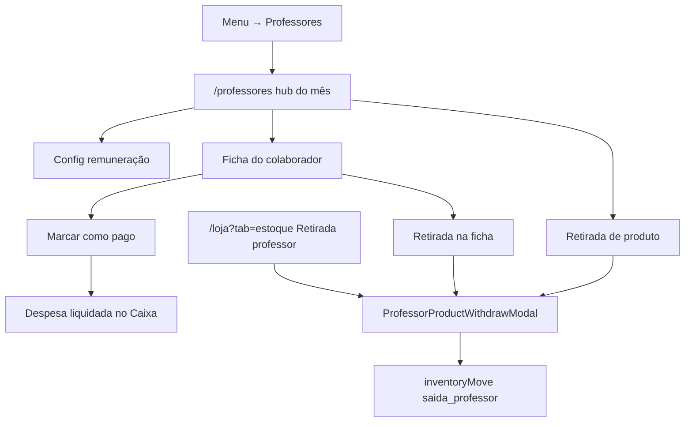

# Professores — fechamento mensal

| Campo | Valor |
|---|---|
| **id** | `operacao.professores.fechamento` |
| **módulo** | Operação / Config |
| **personas** | owner, admin (fechar e configurar); member (retirada se estoque ativo) |
| **rotas** | `/professores`, `/professores?month=YYYY-MM`, `/professores?month=&staff=` |
| **pré-requisitos** | Academia selecionada; roster/Equipe com professores ou instrutores; módulo `inventory` para retiradas; módulo `finance` para marcar pago |
| **status** | revisado (código) |
| **última revisão** | 2026-10-09 |
| **validação** | [VALIDATION.md](../VALIDATION.md) |

**Specs relacionadas:** [2026-10-08-professores-fechamento-design.md](../../superpowers/specs/2026-10-08-professores-fechamento-design.md)

**Harness relacionado:** `npm test -- professorCompensation professorClosing stockMoveFields professorCompensationStorage`

**Arquivos-chave:** `src/pages/Professores.jsx`, `src/components/professores/*`, `src/lib/professorClosingApi.js`, `src/lib/professorCompensationApi.js`, `src/pages/Inventory.jsx` (atalho retirada)

---

## Resumo

O owner/admin fecha o mês por professor ou instrutor: soma créditos (aulas confirmadas + experimentais compareceu), abate retiradas de produto e marca o líquido como pago (despesa liquidada no Caixa, categoria Salários). Retirada de produto usa o mesmo modal em **Professores** e em **Loja → Estoque**.

---

## Diagrama de fluxo

---

## Mapa de telas

| # | Rota | Componente | Ação do usuário | Resultado esperado |
|---|---|---|---|---|
| 1 | `/professores` | `Professores` + `ProfessoresHub` | Abrir hub do mês | Lista com créditos, débitos, líquido, status |
| 2 | `?month=YYYY-MM` | Hub | Trocar mês | Recarrega agregação do período |
| 3 | `?staff=<ref>` | `ProfessorClosingSheet` | Abrir ficha | Breakdown aulas / experimentais / retiradas |
| 4 | Página (owner/admin) | `ProfessorCompensationConfig` | Ajustar R$/aula, experimental, % produto, overrides | Persistência via `professor-compensation` |
| 5 | Hub / ficha / Estoque | `ProfessorProductWithdrawModal` | Registrar retirada | `saida_professor` + débito no fechamento |
| 6 | Ficha (owner/admin) | Marcar como pago | `ConfirmDialog` | Snapshot `pago` + `finance_tx_id` (origem `professor_closing`) |

---

## A — Auditoria operacional

### Pré-condições de dados

- [ ] Academia selecionada no contexto correto (multi-tenant)
- [ ] Professores/instrutores no roster ou Equipe
- [ ] Confirmações de staff / experimentais no mês (para créditos)
- [ ] `modules.inventory` para retirada; `modules.finance` para marcar pago

### Checklist passo a passo

1. [ ] `/professores` carrega hub do mês corrente
2. [ ] Troca de mês atualiza a lista
3. [ ] Clique em pessoa abre ficha com breakdown
4. [ ] Owner/admin vê e salva config de remuneração
5. [ ] Retirada pela página Professores baixa estoque e aparece nos débitos
6. [ ] Retirada pelo atalho **Retirada professor** em Estoque usa o mesmo modal
7. [ ] Marcar pago cria despesa liquidada (Salários) e trava a ficha
8. [ ] Member não marca pago nem edita config; pode retirar se estoque ativo
9. [ ] Multi-tenant: só dados da academia atual

### Estados de erro conhecidos

| Situação | Feedback esperado | Referência |
|---|---|---|
| Falha ao carregar mês | `ErrorBanner` + retry | [docs/ux-feedback.md](../../ux-feedback.md) |
| Estoque insuficiente na retirada | `FieldError` no modal | `ProfessorProductWithdrawModal` |
| Falha ao marcar pago | Toast / dialog de erro | `professorClosingApi` |

### Permissões e multi-tenant

- Dados isolados por `academyId`; ver [docs/multi-tenant-conventions.md](../../multi-tenant-conventions.md).
- Marcar pago e config: owner/admin. Retirada: quem tem estoque ativo (incl. member).

### Critérios de fluxo saudável vs regressão

**Saudável:** líquidos batem com aulas + experimentais − retiradas; pago gera TX no Caixa; retirada nos dois atalhos gera o mesmo tipo `saida_professor`.

**Regressão:** member marca pago; retirada sem `staff_ref`; despesa em pró-labore de sócio; leak cross-tenant.

---

## B — Roteiro de demonstração em vídeo

**Duração alvo:** 3–4 min

### Dados de demonstração sugeridos

| Entidade | Valor fictício |
|---|---|
| Professor | João Silva — 8 aulas, 2 experimentais |
| Retirada | Kimono M × 1 com 30% desc. |
| Pagamento | PIX na conta principal |

### Cenas

| Cena | Tela | Narração sugerida | Gancho de valor |
|---|---|---|---|
| 1 | Hub | "No fim do mês fecho cada professor em um lugar." | Fechamento unificado |
| 2 | Ficha | "Aulas e experimentais viram crédito; produto retirado abate." | Transparência |
| 3 | Retirada | "Registro a retirada aqui ou no estoque — mesma baixa." | Dois atalhos |
| 4 | Pago | "Marco pago e já cai no caixa como salário." | Financeiro integrado |

### O que não mostrar

- Dados reais de colaboradores ou valores de produção
- Tokens, IDs internos, console do navegador

---

## Variações e atalhos

- **Desktop vs mobile:** hub e ficha na mesma rota; modal de retirada full-screen em mobile via `ModalShell`
- **Estoque:** botão **Retirada professor** na toolbar de `/loja?tab=estoque` — ver [estoque-movimentacoes.md](../vendas/estoque-movimentacoes.md)
- **Equipe / roster:** identidade dos colaboradores — [equipe-colaboradores.md](../config/equipe-colaboradores.md)
- **Caixa:** lançamento com origem `professor_closing` — [lancamentos-caixa.md](../financeiro/lancamentos-caixa.md)

---

## Histórico de revisão

| Data | Autor | Mudança |
|---|---|---|
| 2026-10-09 | — | Criação inicial (Task 8) |
