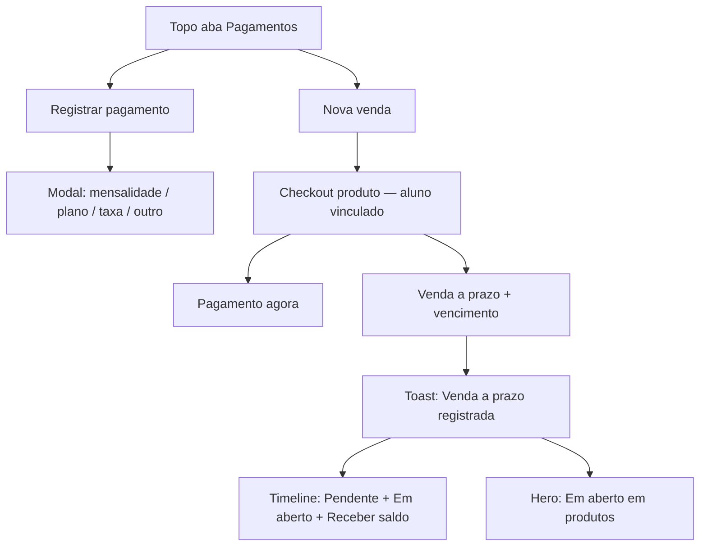

# Clareza: venda a prazo e em aberto no perfil do aluno

**Data:** 2026-10-14  
**Status:** implementado — ver plano `docs/superpowers/plans/2026-10-14-perfil-venda-a-prazo-clareza.md`  
**Origem:** revisão do perfil — operador só via “Pagamento” e não encontrava venda a prazo / em aberto.

**Specs / fluxos relacionados:**

- [2026-06-15-modal-venda-produto-PRODUCT.md](./2026-06-15-modal-venda-produto-PRODUCT.md) — Fluxo B perfil (“Receber depois”)
- [2026-07-16-student-profile-payments-status-first-design.md](./2026-07-16-student-profile-payments-status-first-design.md) — hero status-first
- [2026-09-21-student-profile-historico-narrativo-design.md](./2026-09-21-student-profile-historico-narrativo-design.md) — timeline narrativa
- [docs/flows/crm/aluno-perfil-presenca.md](../../flows/crm/aluno-perfil-presenca.md)
- [docs/flows/vendas/pdv-nova-venda.md](../../flows/vendas/pdv-nova-venda.md)

**Arquivos-chave (hoje):**

- `src/components/student/StudentFinancialTimeline.jsx` — CTAs + hero + timeline
- `src/components/student/StudentPaymentModal.jsx` — modal unificado (pagamento + produto)
- `src/components/student/StudentProductSaleStep.jsx` — checkout perfil (`receiveLater`)
- `src/components/sales/SalesNewSaleTab.jsx` — Loja/PDV (`deferredSale`)
- `src/lib/studentFinancialTimeline.js` — `productDebtLabel`, badges, subtítulos

---

## 1. Problema

A capacidade de **venda a prazo** já existe no perfil (tipo **Produto** → checkbox **Receber depois** → `deferred: true`), mas o processo não é óbvio:

1. **Entrada** — um único CTA **+ Registrar pagamento** sugere só mensalidade/taxa.
2. **Checkout** — rótulo **Receber depois** não bate com a Loja (**Vender a prazo…**).
3. **Acompanhamento** — dívida de produtos existe (`productDebtLabel`: “Dívida em produtos…”), mas o perfil não deixa claro de forma consistente o que está **em aberto** (plano vs produto) nem alinha a linguagem com a Loja.

**Objetivo:** deixar a jornada clara ponta a ponta (entrada → checkout → em aberto → receber saldo), com **a mesma linguagem** no perfil e na Loja/PDV, **sem mudar regras de negócio** nem API.

---

## 2. Glossário canônico

| Conceito | Rótulo único (perfil + Loja + toasts) |
|---|---|
| Venda sem receber agora | **Venda a prazo** |
| Venda criada sem pagamento | status **Pendente**; saldo **Em aberto** |
| Receber o que falta | **Receber saldo** |
| CTA produto no perfil | **Nova venda** |
| CTA mensalidade/taxa/outro | **Registrar pagamento** |

Texto de apoio permitido na Loja (checkbox): “sem pagamento agora” — o rótulo principal permanece **Venda a prazo**.

---

## 3. Jornada alvo

---

## 4. Entrada no perfil (dois CTAs)

No `SituationHero` (e qualquer CTA equivalente no topo da aba Pagamentos):

- **Registrar pagamento** — abre `StudentPaymentModal` **sem** opção **Produto** (só mensalidade / plano com cobertura / taxa / outro).
- **Nova venda** — abre o mesmo `StudentPaymentModal` em modo produto-only (`payment_type` fixo em produto; seletor de tipo oculto; título **Nova venda** / **Venda de produto**). Reutiliza `StudentProductSaleStep`; sem extrair modal novo.

Layout: lado a lado no desktop; empilhados no mobile. Visíveis quando o operador pode gerir pagamentos/vendas e o módulo `sales` estiver ativo para **Nova venda**. Com plano trancado, manter a política atual de CTAs (não inventar novo comportamento de freeze).

Remover o radio **Produto** do fluxo “Registrar pagamento” para evitar o caminho confuso atual.

Link “Abrir checkout completo na Loja” (produto + mensalidade/taxa) permanece no modal de pagamento ou no checkout de venda, como hint — fora do núcleo desta clareza.

---

## 5. Visibilidade de “em aberto” (plano e produto)

O perfil deve deixar óbvio se há pendência de **plano** e/ou de **produto**.

| Fonte | UI |
|---|---|
| Plano | Hero de situação atual (“Em atraso”, “Pagamento parcial…”, “Em dia”, etc.) — mantém lógica existente |
| Produtos | Linha dedicada quando `sumProductDebt(sales) > 0`: **Em aberto em produtos: R$ X** (substitui copy “Dívida em produtos…”) |
| Ambos | As duas informações juntas; CTAs dos dois tipos continuam disponíveis |

Regras:

- Plano “Em dia” **não** esconde **Em aberto em produtos**.
- Totais do extrato (`Em aberto`) continuam somando saldo de vendas pendente/parcial — mesmo significado.
- Badge/timeline de venda: **Pendente** / **Parcial**; subtítulo com **Em aberto** (já existe); ação **Receber saldo** (já existe).

---

## 6. Checkout e alinhamento Loja

| Superfície | Hoje | Alvo |
|---|---|---|
| Perfil `StudentProductSaleStep` | “Receber depois” | **Venda a prazo** |
| Loja `SalesNewSaleTab` | “Vender a prazo (sem pagamento agora)” | **Venda a prazo** (+ apoio “sem pagamento agora”) |
| Toast perfil a prazo | “Venda registrada — pagamento pendente.” | **Venda a prazo registrada** |
| Toast Loja a prazo | “Venda a prazo registrada” | manter |
| Toast parcial | saldo em aberto | manter ideia; alinhar wording se divergir |

Comportamento inalterado: toggle a prazo esconde `SalesPaymentBlock`, exige `due_date`, payload `deferred: true`, `pagamentos: []`.

Hints em `financeTermHints.js` (ou similares) que citam “Receber depois” devem apontar para **Venda a prazo**.

---

## 7. Escopo técnico (o que muda / o que não muda)

**Muda (UI/copy/wiring):**

- CTAs no hero / timeline
- Entrada do modal (produto fora de “Registrar pagamento”; entrada dedicada “Nova venda”)
- Labels do toggle, toasts, `productDebtLabel`
- Docs de fluxo (`aluno-perfil-presenca`, `pdv-nova-venda`) no mesmo PR de implementação
- Testes de copy/fluxo (timeline, payment modal, product sale step)

**Não muda:**

- API de `createSale` / liquidação / status `pendente`|`parcial`
- Parcelamento no cartão (spec separada `2026-06-23-parcelamento-vendas`)
- Extrair componente de venda para arquivo/modal totalmente novo (abordagem descartada)
- Mixed checkout produto+cobrança (continua na Loja; a prazo com cobranças continua bloqueado)

---

## 8. Critérios de aceite

1. No perfil, operador vê **Registrar pagamento** e **Nova venda** (com `sales` ativo).
2. **Nova venda** abre checkout de produto sem precisar escolher tipo “Produto” num modal de pagamento.
3. Checkbox/toggle chama **Venda a prazo** no perfil e na Loja.
4. Confirmar a prazo → toast **Venda a prazo registrada**; timeline com **Pendente** + **Em aberto** + **Receber saldo**.
5. Com venda pendente/parcial, hero mostra **Em aberto em produtos: R$ …** mesmo se o plano estiver em dia.
6. Com mensalidade em atraso e venda em aberto, as duas informações aparecem.
7. Nenhuma string de produto residual “Receber depois” nas UIs de venda (perfil/Loja); hints financeiros atualizados.
8. Nenhuma mudança de contrato de API nem de regras de `deferred`.

---

## 9. Testes sugeridos

- Atualizar / adicionar asserts de copy em `studentFinancialTimeline` (`productDebtLabel`).
- Fluxo modal: abrir **Nova venda** vs **Registrar pagamento** (produto ausente no segundo).
- Product sale step: toggle **Venda a prazo** + toast.
- Smoke Loja: label do toggle alinhado.
- Harness existente de vendas/perfil: ajustar strings quebradas pelos renomes.

---

## 10. Decisão de design

Aprovado em brainstorming (2026-10-13/14):

- Problema completo: entrada + checkout + acompanhamento (**D**)
- Escopo: UI perfil + mesma linguagem na Loja (**C**)
- Entrada: dois CTAs (**B**)
- Abordagem: glossário + CTAs separados (não só rename; não extrair modal novo)
